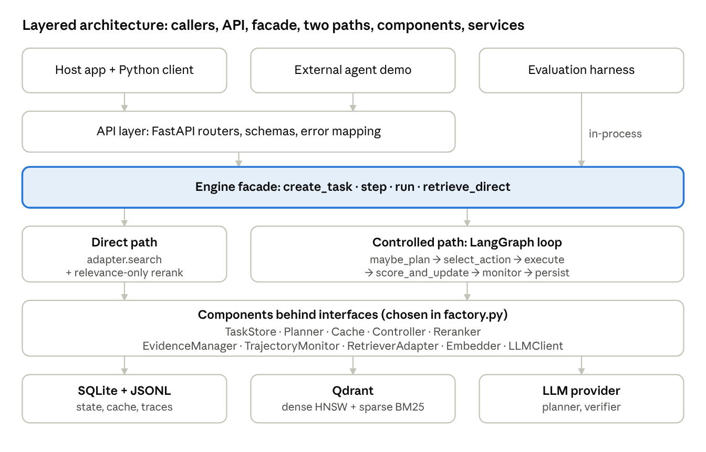
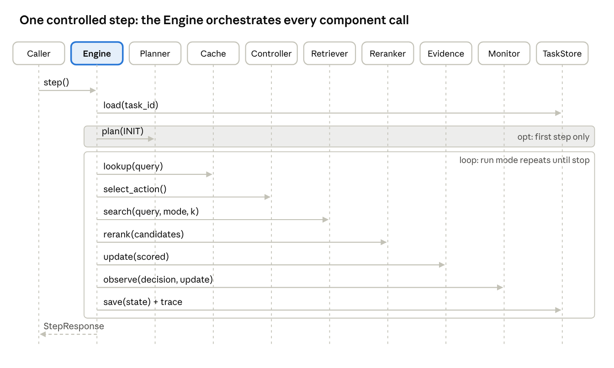
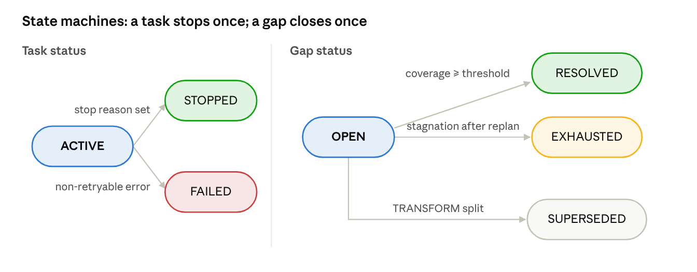

# Software Design Specification (SDS)

**AI-Native Retrieval Engine for Agentic Workflows**

Version 1.1 · 4 October 2026

This SDS describes how the engine meets every requirement in the companion SRS: a layered, interface-driven Python service whose controlled path is a LangGraph loop over an explicit retrieval state, with a deterministic utility-based controller. It follows IEEE 1016 (software design descriptions). Every design element traces to SRS requirement IDs in Section 10.

## Document control

| Field | Value |
| --- | --- |
| Project | AI-Native Retrieval Engine for Agentic Workflows |
| Programme | BS (CS), FAST School of Computing, FAST-NUCES Karachi, Fall 2026 |
| Team | Samay Kumar (23K-0620), Vishal Kothari (23K-0040), Kabir Raj (23K-0702) |
| Supervisor | Zulfiqar Ali Memon |
| Companion document | SRS v1.1, 4 Oct 2026 |

| Version | Date | Author | Change |
| --- | --- | --- | --- |
| 1.0 | 26 Sep 2026 | Project team | Initial SDS |
| 1.1 | 4 Oct 2026 | Project team | Windows-only deployment; supervisor and approval signatures; aligned with ADR-009; API limits from config (ADR-010); deviations recorded (ADR-011); NDCG@k added; owners per proposal Table II |

| Approval | Name | Signature | Date |
| --- | --- | --- | --- |
| Supervisor | Zulfiqar Ali Memon | Zulfiqar |  |
| Group members | Samay Kumar, Vishal Kothari, Kabir Raj | Samay, Vishal, Kabir |  |

## 1. Introduction

### 1.1 Purpose and audience

The SDS is the blueprint the team implements and the evaluators assess. It fixes component boundaries, data structures, algorithms and interfaces precisely enough that each module can be built and tested independently.

### 1.2 Scope

The design covers the engine service, its controlled and direct paths, the Qdrant retrieval backend adapter, the LLM client, persistence, the evaluation subsystem (baselines, harness, metrics, statistics) and the external agent demo. Final answer generation inside host applications is outside the design, except the shared generator used for evaluation.

### 1.3 Design goals

| ID | Goal | Driven by |
| --- | --- | --- |
| DG-1 | Pluggability: the host keeps its retriever and generator; the engine wraps an adapter | FR3, FR11, NFR-M1 |
| DG-2 | Fair measurability: every compared system shares one index, embedder, reranker and generator | FR10, VR-1 |
| DG-3 | Transparency: every decision is deterministic and logged with its inputs | FR6, NFR-O1 |
| DG-4 | Boundedness: planning, retries, steps, calls and cost are capped | FR4, FR8, NFR-P4/P5 |
| DG-5 | Reproducibility: runs are fully described by config, commit and data hashes | NFR-X1–X4 |
| DG-6 | Simplicity: synchronous code a three-person team can debug | C-7, ADR-002 |

### 1.4 Design principles

- **Contracts first.** All shared data are Pydantic v2 models in one module; components exchange only these models.
- **Interfaces, not classes.** Each component has an abstract interface; one factory chooses implementations from configuration.
- **Single writer per field.** A binding ownership matrix states which component may write each state field.
- **No magic numbers.** Every threshold, weight, model name and path is a configuration key.
- **Untrusted retrieved text.** Retrieved content never reaches a system prompt, and never selects actions.

### 1.5 References

SRS v1.1; FYP proposal (18 Sep 2026); IEEE Std 1016-2009; repository specifications `docs/ARCHITECTURE.md`, `STATE_SPEC.md`, `ACTION_POLICY.md`, `PLANNER_SPEC.md`, `CACHE_SPEC.md`, `RERANK_SPEC.md`, `EVIDENCE_MANAGER_SPEC.md`, `RETRIEVAL_SPEC.md`, `LLM_CLIENT_SPEC.md`, `API_CONTRACT.md`, `EVAL_PROTOCOL.md`, `CONFIG_SCHEMA.md`; ADR-001 to ADR-005 and ADR-009 to ADR-011.

## 2. Architectural design

### 2.1 Architectural style

The engine is a layered, service-oriented application with a pipes-and-filters loop at its core. Callers reach a thin API layer or the Engine facade directly (evaluation). The facade chooses the direct path or the controlled LangGraph loop. Both paths use the same components, each hidden behind an interface.



*layered architecture · 6 layers, 2 execution paths*

The evaluation harness calls the facade in-process so that experiments and the API run identical code. Only the harness bypasses HTTP.

### 2.2 Component decomposition

| Component | Package | Responsibility | Interface (key methods) | Owner |
| --- | --- | --- | --- | --- |
| API layer | `engine/api` | HTTP routing, validation, error mapping | FastAPI routers | Vishal |
| Engine facade | `engine/core.py` | Entry point for both paths; builds the graph | `create_task`, `step`, `run`, `retrieve_direct` | Samay (direct path: Kabir) |
| Factory | `engine/factory.py` | Instantiates concrete components from config | `build(config)` | Samay |
| TaskStore | `engine/state` | Persist and load S\_t with optimistic locking | `create`, `load`, `save` | Samay |
| Planner | `engine/planner` | Decompose, rewrite, split; validate; fall back | `plan(state, mode)` | Vishal |
| Cache | `engine/cache` | Task-local result cache and REUSE gate | `lookup`, `put` | Kabir |
| Controller | `engine/controller` | Preconditions, utility scoring, action choice | `select_action(state, cache_hit)` | Samay |
| RetrieverAdapter | `engine/retrieval` | Dense, sparse, hybrid search on Qdrant | `search`, `health` | Kabir |
| Embedder | `engine/embeddings` | Query and passage embeddings, LRU cache | `embed_queries`, `embed_passages` | Kabir |
| Reranker | `engine/rerank` | Cross-encoder plus state-aware MMR selection | `rerank(query, candidates, state)` | Samay |
| EvidenceManager | `engine/evidence` | Accept evidence, resolve gaps, evidence gain | `update(state, scored, step)` | Samay |
| TrajectoryMonitor | `engine/monitor` | Stagnation, gap advancement, stop checks | `observe(state, decision, update)`, `advance(state)` | Samay |
| Trace writer | `engine/monitor/trace.py`, `logging.py` | TraceStep records and structured event log for the engine and all baselines | TraceStep / event schema (OBSERVABILITY) | Vishal |
| LLMClient | `engine/llm` | Providers, structured output, cache, caps, cost | `structured`, `text` | Vishal |
| Client | `client/` | Typed HTTP client for hosts and agents | one method per endpoint | Vishal |
| Evaluation | `eval/`, `baselines/` | Datasets, baselines, runner, metrics, stats, reports | `run_task(task, ctx)` | Vishal |
| Ingestion | `data/` | Download, chunk, embed, index, gold map, split | `python -m data.ingest` | Kabir |

### 2.3 Dependency rules

1. A component may import only `engine.state.models`, `engine.config`, and other components' `interfaces.py`.
2. Only `engine/factory.py` imports concrete component classes.
3. Only `engine/llm` imports provider SDKs; only `engine/embeddings` loads the embedding model.
4. `examples/` and host applications import only `client` and `client.models`.
5. An automated test parses imports and fails the build if any rule is broken.

### 2.4 Key design decisions

| ADR | Decision | Rationale | Status |
| --- | --- | --- | --- |
| ADR-001 | BGE-base embeddings, 384-token sentence-aware chunks, BM25 sparse, versioned collection names | Good quality on CPU; one embedder for all similarity signals | Proposed |
| ADR-002 | Synchronous core; SQLite TaskStore is the only persisted state; LangGraph without checkpointer | One source of truth; simpler debugging | Accepted |
| ADR-003 | Checksummed MultiHop-RAG release; stratified 70/30 split, fixed seed | Reproducibility; no test leakage | Proposed |
| ADR-004 | Planner and generator models chosen after a 50-task pilot | Reliability of JSON output and cost | Proposed |
| ADR-005 | Pretrained BGE cross-encoder, relevance mapped to \[0,1\] | No training in scope; strong on news passages | Proposed |
| ADR-009 | State contract amendments: per-iteration scratch, current-gap fields derived from the gap, state and cache committed atomically | Makes the loop implementable without ownership conflicts | Proposed |
| ADR-010 | API request limits read from configuration (`api.*`, `retrieval.default_k`, `retrieval.max_k`) | No literal limits; respects the reranker input cap | Proposed |
| ADR-011 | Recorded deviations from the approved proposal (Windows-only setup; no LangGraph checkpointer; gain signal; planner inputs; cache storage) | Supervisor approval of design changes | Proposed (supervisor) |
| — | Deterministic rule-plus-utility controller rather than an LLM policy | Transparency, injection resistance, no training | Fixed by proposal |

### 2.5 Package structure

```text
engine/
  config.py  core.py  factory.py  errors.py
  state/       models.py  store.py  serialization.py  invariants.py  interfaces.py
  graph/       graph.py  nodes.py
  planner/     planner.py  validator.py  entities.py  prompts/{init,rewrite,split}.j2
  cache/       task_cache.py  normalize.py
  controller/  policy.py  signals.py
  retrieval/   qdrant_adapter.py
  embeddings/  st_embedder.py
  rerank/      cross_encoder.py  state_aware.py
  evidence/    manager.py
  monitor/     monitor.py  trace.py  logging.py
  llm/         client.py  cache.py  providers/{anthropic,openai_compatible,fake}.py
  api/         app.py  routers.py  schemas.py
client/        retrieval_client.py  models.py
baselines/     dense_oneshot.py  hybrid_oneshot.py  fixed_iteration.py
eval/          datasets/  run.py  generator.py  metrics.py  stats.py  report.py
data/          download.py  ingest.py
examples/      langgraph_agent/
```

## 3. Behavioural design

### 3.1 One controlled step

Each call to `Engine.step` runs one iteration; `Engine.run` repeats iterations until the task stops. The Engine (through LangGraph nodes) is the only caller of components; components never call each other.



*sequence diagram · one controlled step, 10 participants*

If the chosen action produces no candidates (TRANSFORM or STOP), the rerank and evidence calls are skipped. A failure anywhere before `save` aborts the iteration, so stored state stays at the last completed step.

### 3.2 LangGraph node design

Nodes are plain functions `node(graph_state, ctx) -> partial update`; `ctx` carries component instances from the factory. Per-iteration data (cache hit, candidates, scores, queued cache entries) travels in a transient `scratch` that is never persisted. The graph is compiled without a persistent checkpointer (ADR-002).

| Node | Behaviour | Fields written |
| --- | --- | --- |
| `maybe_plan` | If `needs_initial_plan`: call `Planner.plan(INIT)`, create gaps, then call `TrajectoryMonitor.advance` to set the current gap (the pending query and need type are read from that gap); else no-op | gaps, current gap ID, query history, plan events, LLM budget, needs\_initial\_plan |
| `select_action` | `Cache.lookup` for the pending query, then `Controller.select_action` | last decision |
| `execute` | Run the chosen action (Section 3.3); a REWRITE updates only the current gap's query and need type; a SPLIT supersedes the gap, creates its children and calls `advance` | retrieval history, seen IDs, budget counters; gaps for TRANSFORM |
| `score_and_update` | If candidates exist: rerank, then evidence update; queue a cache entry for fresh retrievals (committed by `persist`) | evidence, gap resolution, last result, last update, reranker counter |
| `monitor` | Stagnation bookkeeping, gap advancement, stop checks | stagnation, transforms, gain EMA, current gap, status, stop reason |
| `persist` | Increment `budget.steps_used`; save the state and the queued cache entries to TaskStore in one transaction; append trace record | budget.steps\_used, version, updated time, cache entries |

After `persist`, a conditional edge returns to `maybe_plan` while the task is active in run mode, and ends otherwise. `recursion_limit` is derived from `max_steps` as a safety net; the monitor is the real stop mechanism.

### 3.3 Action execution

| Action | Backend call | Produces candidates | Budget effect |
| --- | --- | --- | --- |
| REUSE | None; cached candidates | Yes | steps + 1 |
| DENSE | `search(pending query, dense, default_k)` | Yes | steps + 1, retrieval calls + 1 |
| SPARSE\_HYBRID | `search(pending query, sparse if lexical else hybrid, default_k)` | Yes | steps + 1, retrieval calls + 1 |
| RERANK\_EXPAND | Re-issue last query at depth + `expand_step_k` (≤ `max_k`); keep unseen only | Yes | steps + 1, retrieval calls + 1 |
| TRANSFORM | `Planner.plan(REWRITE or SPLIT)` | No | steps + 1, LLM calls + attempts |
| STOP | None | No | steps + 1 |

### 3.4 State machines



*state machines · task status and gap status*

A task is ACTIVE until the monitor or controller sets a stop reason (STOPPED) or a non-retryable error occurs (FAILED); both are terminal. A gap starts OPEN and closes exactly once. A SUPERSEDED parent counts as resolved when all its children are RESOLVED. The task stops with ALL\_GAPS\_RESOLVED when no gap is OPEN and every root gap is resolved, and with STAGNATION when no gap is OPEN otherwise.

## 4. Data design

All shared data are Pydantic v2 models in `engine/state/models.py`; this section is their data dictionary. Vector fields are persisted internally but excluded from API responses, traces and bundles.

### 4.1 Enumerations

| Enum | Values |
| --- | --- |
| NeedType | semantic, lexical, mixed |
| RetrievalMode | dense, sparse, hybrid |
| Action | REUSE, DENSE, SPARSE\_HYBRID, TRANSFORM, RERANK\_EXPAND, STOP |
| GapStatus | open, resolved, superseded, exhausted |
| TaskStatus | active, stopped, failed |
| StopReason | ALL\_GAPS\_RESOLVED, STAGNATION, LOW\_MARGINAL\_UTILITY, MAX\_STEPS, MAX\_RETRIEVAL\_CALLS, MAX\_LLM\_CALLS, MAX\_TOKENS, ONE\_SHOT\_COMPLETE, FIXED\_ITERATIONS\_COMPLETE, ERROR |
| PlanMode / PlanStatus | init, rewrite, split / accepted, rejected, fallback |

### 4.2 RetrievalState (S\_t)

| Field | Type | Meaning (S\_t element) |
| --- | --- | --- |
| schema\_version, task\_id, version, status, stop\_reason | int, str, int, enum, enum? | Schema version, identity, optimistic-lock version, lifecycle (`budget.steps_used` is the only step counter) |
| goal | str | G, immutable |
| gaps | list\[EvidenceGap\] | Decomposed information needs |
| current\_gap\_id | str? | g\_t (identifies the current gap) |
| current\_subgoal, pending\_query, current\_need\_type | str, str, NeedType (computed) | Derived from the current gap's description, query and need type; not stored |
| needs\_initial\_plan | bool | True until INIT planning runs |
| evidence | list\[EvidenceItem\] | E\_t |
| query\_history | list\[QueryRecord\] | Q\_t, append-only |
| retrieval\_history | list\[RetrievalRecord\] | R\_t, append-only |
| budget | Budget | B\_t |
| seen\_candidate\_ids, last\_result | list, LastResult? | Support for RERANK\_EXPAND (depth = `last_result.depth`) and repeat detection |
| stagnation\_count, transforms\_in\_streak, action\_gain\_ema | int, int, dict | Monitor bookkeeping |
| last\_decision, last\_update, plan\_events | ActionDecision?, EvidenceUpdate?, list | Last step's decision, evidence result, planner log |
| created\_at, updated\_at | datetime | Timestamps |

### 4.3 Supporting models

| Model | Key fields |
| --- | --- |
| Budget | max\_steps, max\_retrieval\_calls, max\_llm\_calls, max\_tokens; \*\_used counters; reranker\_calls\_used; `pressure()` = max utilisation ratio in \[0,1\] |
| EvidenceGap | gap\_id, description, query, need\_type, status, parent\_gap\_id, resolved\_by, created\_at\_step, closed\_at\_step |
| Candidate | chunk\_id, doc\_id, text, retrieval\_score, rank, mode, metadata, vector |
| ScoredCandidate | candidate, relevance, gap\_coverage, novelty, redundancy, final\_score, covered\_gap\_id |
| EvidenceItem | evidence\_id (= chunk\_id), doc\_id, text, summary, relevance, novelty, final\_score, source\_action, query, metadata, added\_at\_step, supports\_gap\_ids, pinned, vector |
| QueryRecord / RetrievalRecord | step, gap, query, need type, source / step, action, mode, query, k, candidate IDs, new IDs, cache\_hit, latency |
| PlanLLMOutput / PlanResult / PlanOutcome | subgoals, referenced\_entities, rationale (what the LLM returns; no mode) / mode, subgoals (description, query, need\_type), referenced\_entities, rationale / result, events, llm\_calls, tokens |
| ActionDecision | action, eligible, scores {G, C, R, L, U} per action, stop\_reason, plan\_mode (TRANSFORM only), rule |
| CacheEntry / CacheHit | task\_id, normalized\_query, query\_vector, need\_type, mode, candidates, accepted\_ids / entry, similarity, match |
| EvidenceUpdate | accepted, rejected {id: code}, evicted, resolved\_gap\_ids, gap\_resolutions, item\_changes, evidence\_gain |
| EvidenceBundle | task\_id, system, goal, evidence (by score), gaps, stop\_reason, trace\_summary |
| TraceStep | run/task/system IDs, step, action, rule, eligible set, utility scores, query, mode, k, cache hit, candidate/accepted/rejected/evicted IDs, resolved gaps, evidence gain, plan events, stage latencies, LLM calls, tokens, budget after, stop reason, timestamp |

### 4.4 Field-ownership matrix

| Field(s) | Only writer |
| --- | --- |
| task\_id, goal, created\_at, budget maxima | TaskStore.create |
| version, updated\_at, budget.steps\_used | persist node / TaskStore.save |
| gap creation and supersession, a REWRITE's gap query and need type, query history, plan events, needs\_initial\_plan | Planner (via `maybe_plan` or TRANSFORM) |
| evidence, gap resolution | EvidenceManager |
| gap exhaustion, gap advancement (current gap ID), stagnation, transforms, gain EMA, status, stop reason | TrajectoryMonitor |
| last\_decision | select\_action node |
| retrieval history, seen IDs | execute node |
| last\_result, last\_update | score\_and\_update node |
| budget usage counters | the node that consumed the resource |
| status = failed, stop reason = ERROR (non-retryable error) | Engine facade, outside the graph |

### 4.5 Invariants

1. Budget usage never exceeds its cap (tokens may exceed by at most one call, then MAX\_TOKENS).
2. Evidence IDs are unique; evidence count ≤ `evidence.max_items`.
3. Query, retrieval and plan histories are append-only.
4. A RESOLVED gap's `resolved_by` names a pinned evidence item.
5. status = active if and only if stop\_reason is empty; stop\_reason is set once.
6. While active and planned, the current gap is OPEN.
7. Open plus resolved gaps ≤ `planner.max_gaps`.
8. version increases by exactly 1 per save.

### 4.6 SQLite schema

```sql
PRAGMA journal_mode = WAL;

CREATE TABLE tasks (
  task_id     TEXT PRIMARY KEY,
  version     INTEGER NOT NULL,
  status      TEXT NOT NULL CHECK (status IN ('active','stopped','failed')),
  state_json  TEXT NOT NULL,          -- RetrievalState incl. vectors
  created_at  TEXT NOT NULL,
  updated_at  TEXT NOT NULL
);

CREATE TABLE cache_entries (
  task_id     TEXT NOT NULL REFERENCES tasks(task_id),
  entry_id    TEXT NOT NULL,
  normalized_query TEXT NOT NULL,
  mode        TEXT NOT NULL,
  entry_json  TEXT NOT NULL,          -- CacheEntry incl. candidate vectors
  created_at_step INTEGER NOT NULL,
  PRIMARY KEY (task_id, entry_id)
);
CREATE INDEX idx_cache_task_query ON cache_entries(task_id, normalized_query);

-- separate file: llm_cache.sqlite3
CREATE TABLE llm_cache (
  key           TEXT PRIMARY KEY,     -- sha256 of provider, model, role, params, messages, schema, namespace
  response_json TEXT NOT NULL,
  usage_json    TEXT NOT NULL,
  created_at    TEXT NOT NULL
);
```

`save(state, expected_version, cache_entries)` runs `UPDATE tasks SET …, version = version + 1 WHERE task_id = ? AND version = ?` and writes the iteration's queued cache entries in the same transaction; zero rows updated raises `TaskConflict` (HTTP 409) and nothing is written.

### 4.7 Qdrant collection

| Item | Design |
| --- | --- |
| Collection | `<dataset>_v<N>`, for example `multihop_v1`; new N for any index-defining change |
| Dense vector | Named `dense`, 768 dimensions, cosine distance, HNSW m = 16, ef\_construct = 128 |
| Sparse vector | Named `sparse`, BM25 encoding (IDF handling as verified for the pinned version) |
| Point ID | UUIDv5(fixed namespace, chunk\_id); chunk\_id itself = first 16 hex of sha1(doc\_id:char\_start) |
| Payload | chunk\_id, doc\_id, text, title, source, url, published\_at, char\_start, char\_end, dataset |
| Payload indexes | Keyword on chunk\_id and doc\_id |

### 4.8 Run artefacts

```text
eval/runs/<YYYYMMDD-HHMMSS>_<experiment>_<git7>/
  manifest.json   config.resolved.yaml   events.jsonl
  b<B>/traces/<task_id>.jsonl   b<B>/bundles/<task_id>.json
  b<B>/answers.jsonl   b<B>/per_task.csv   b<B>/metrics.json
  report/
```

## 5. Component design

Each subsection gives the component's responsibility, algorithm and failure behaviour. Configuration keys are named in `code`; defaults live in `configs/base.yaml`.

### 5.1 Query planner (FR4)

**Modes.** INIT at task start creates 1 to `planner.max_subgoals` gaps. REWRITE replaces the current gap's query. SPLIT supersedes the current gap with 2 to 3 child gaps; it is used when the gap already has 2 or more failed queries and the gap cap allows.

**Inputs.** Goal; current gap and its previous queries; other open gaps; up to `planner.max_evidence_summaries` evidence summaries (deterministic 300-character truncations), wrapped as untrusted evidence.

**Validation order.** SCHEMA → COUNT → EMPTY\_OR\_DUPLICATE → UNGROUNDED\_ENTITY (fuzzy match ≥ `planner.entity_match_threshold` against goal, gaps and summaries) → UNDECLARED\_ENTITY (deterministic extractor finds a span missing from `referenced_entities`).

```text
for attempt in 1..max_attempts (2):
    result = llm.structured("planner", prompt(mode, attempt, last_reason), PlanLLMOutput)
    if transport failure after LLM-client retries: log REJECTED(LLM_ERROR); continue
    if validate(result): log ACCEPTED(attempt); return result
    log REJECTED(attempt, reason)
log FALLBACK
return fallback(mode)   # INIT: one gap = goal; REWRITE/SPLIT: gap description, else goal
```

Fallback need type uses a heuristic: lexical for short text with an entity, year, ID or quoted string; semantic for why/how/explain questions with no entity; mixed otherwise.

### 5.2 Task-local cache (FR5)

Lookup filters by `task_id` in SQL, then tries an exact normalised match, then the best cosine similarity ≥ `cache.similarity_threshold`. A hit is usable only if its mode serves the need: dense serves semantic and mixed, sparse serves lexical, hybrid serves all. Entries for every fresh retrieval are queued during the iteration and committed with the state in the same `TaskStore.save` transaction; an entry with the same query and mode is replaced; at most `cache.max_entries_per_task` entries, oldest non-exact evicted first. REUSE sends the cached candidates through normal reranking (against the current pending query) and evidence acceptance.

### 5.3 Controller (FR6)

**Selection procedure.**

```text
1. steps exhausted                        -> STOP(MAX_STEPS)
2. E = actions whose preconditions hold
3. retrieval calls exhausted: drop DENSE, SPARSE_HYBRID, RERANK_EXPAND, TRANSFORM
       E empty                            -> STOP(MAX_RETRIEVAL_CALLS)
4. E empty                                -> STOP(MAX_LLM_CALLS or STAGNATION)
5. adaptive actions disabled              -> fixed policy
6. score each a in E: U(a) = alpha*G - beta*C - gamma*R - delta*L
7. a* = argmax U; ties: REUSE > SPARSE_HYBRID > DENSE > RERANK_EXPAND > TRANSFORM
8. U(a*) < min_utility and >= 1 retrieval done -> STOP(LOW_MARGINAL_UTILITY)
9. a* = TRANSFORM: set plan_mode (REWRITE or SPLIT)
10. return a*
```

**Preconditions.** REUSE needs a cache hit. DENSE and SPARSE\_HYBRID need retrieval budget and must not repeat the same query in the same mode; the non-preferred mode becomes eligible after stagnation or once the preferred mode has been tried (strategy switch). RERANK\_EXPAND needs a last result for the current gap, depth below `retrieval.max_k`, and at least one top relevance inside `controller.ambiguous_band`. TRANSFORM needs LLM budget, a remaining transform in the streak, and stagnation or all retrieval actions blocked.

**Utility.** Weights are non-negative and sum to 1.

```latex
U(a \mid S_t) = \alpha\,G_t(a) - \beta\,C_t(a) - \gamma\,R_t(a) - \delta\,L_t(a), \qquad \alpha+\beta+\gamma+\delta = 1
```

For DENSE and SPARSE\_HYBRID the expected gain combines gap alignment, the action's recent gain (exponential moving average) and its fit to the need type:

```latex
G_t(a) = s_{gap}\,\max_{g \in O}\cos(q, e_g) + s_{ema}\,\overline{gain}(a) + s_{type}\,\mathrm{match}(a, \nu)
```

| Signal | REUSE | DENSE / SPARSE\_HYBRID | RERANK\_EXPAND | TRANSFORM |
| --- | --- | --- | --- | --- |
| G (gain) | hit similarity × share of cached candidates not yet in E\_t | formula above | 0.5 × ambiguity + 0.5 × recent gain | min(1, stagnation / patience) |
| C (cost) | cost units / max units × (0.5 + 0.5 × budget pressure) | same | same | same |
| R (redundancy) | 0 | max cosine to earlier queries in the same mode | share of last results already in E\_t | 0 |
| L (latency) | profiled latency / max profiled latency | same | same | same |

Cost units default to REUSE 0, DENSE 1, SPARSE\_HYBRID 1, RERANK\_EXPAND 2, TRANSFORM 2. Latencies come from `configs/latency_profile.yaml` when profiled, else from `controller.default_latency_ms`.

**Worked example (unit test).** With equal weights, budget pressure 0.5, gap alignment 0.8, and a stagnant earlier dense query: U(DENSE) = −0.181, U(SPARSE\_HYBRID) = 0.069, U(TRANSFORM) = −0.3125, so the controller switches strategy to SPARSE\_HYBRID.

### 5.4 Retriever adapter and embedder (FR1, FR3)

`QdrantAdapter.search(query, mode, k)` embeds the query (dense) or encodes it (sparse), and for hybrid issues one Query API request with dense and sparse prefetch of `retrieval.hybrid_prefetch_k` each, fused by RRF. It returns candidates with payload and dense vectors. Timeouts and connection errors raise `BackendError`; partial results are never returned. Scores are not compared across modes. The embedder applies the model's query or passage prefix, normalises vectors and keeps an LRU cache.

### 5.5 State-aware reranker (FR7)

Relevance is the cross-encoder score of (pending query, chunk), mapped to \[0,1\]. Gap coverage is the best cosine to an open gap description. Novelty is one minus the best cosine to accepted evidence. Selection is greedy (MMR-style), penalising redundancy with candidates already selected:

```latex
\mathrm{final}(c) = w_{rel}\,\mathrm{rel}(c) + w_{gap}\,\mathrm{cov}(c) + w_{nov}\,\mathrm{nov}(c) - w_{red}\,\max_{s \in S}\cos(c, s)
```

Output is the top `rerank.top_n_output` (10). With state-awareness disabled, and in all baselines, final = relevance.

### 5.6 Evidence manager (FR8)

Candidates are processed in final-score order and rejected as DUPLICATE, LOW\_RELEVANCE, LOW\_NOVELTY, STEP\_CAP or CAP\_REACHED; otherwise accepted with a deterministic summary. When evidence is full, the lowest-scoring unpinned item is evicted. A gap is resolved by the accepted item with the highest coverage if it reaches `evidence.gap_coverage_threshold`; optional LLM verification handles near-threshold items within the LLM budget. Resolving items are pinned.

```latex
\mathrm{gain}_t = w_{res}\,\frac{|\text{newly resolved gaps}|}{\max(1, |\text{open gaps at step start}|)} + w_{q}\,\frac{1}{|A_t|}\sum_{e \in A_t}\mathrm{rel}(e)\,\mathrm{nov}(e)
```

### 5.7 Trajectory monitor (FR8)

After each step, in order: (1) update gain EMA and stagnation from evidence gain; count TRANSFORM steps in the streak; (2) propagate SUPERSEDED parents; (3) advance to the next OPEN gap when the current one is resolved, or mark it EXHAUSTED after `monitor.stagnation_patience` stagnant steps once the transform allowance is used; (4) check stops in order: all root gaps resolved → ALL\_GAPS\_RESOLVED; no open gaps → STAGNATION; steps → MAX\_STEPS; tokens → MAX\_TOKENS; the controller's STOP → its reason.

### 5.8 LLM client (FR4, NFR-P4/P5)

Roles planner, verifier and generator; providers `anthropic`, `openai_compatible` (hosted OpenAI-style APIs and local servers such as Ollama or LM Studio) and `fake` for tests. Structured output = schema in the system message, fence stripping, JSON parse, Pydantic validation; failure raises `LLMOutputError`. Transport errors are retried with exponential backoff. A SQLite response cache keys on a hash of provider, model, role, parameters, messages, schema and namespace. Budget counts logical calls, cached or not, so behaviour does not depend on cache state. Per-run caps on calls and USD cost abort a run cleanly.

### 5.9 Task store (FR2, NFR-R1/R4)

SQLite in WAL mode; one connection per worker thread. `create` validates and inserts S\_0; `load` deserialises including vectors; `save` performs the version-checked update from Section 4.6. Because `save` happens only in the `persist` node, any exception earlier in an iteration leaves the stored state unchanged.

## 6. Interface design

The REST API is versioned under `/v1`, uses JSON bodies, and is generated from the same Pydantic models the engine uses internally, so schemas cannot drift. OpenAPI documentation is served at `/docs`.

### 6.1 Endpoints

| Method and path | Purpose | Request | Success response |
| --- | --- | --- | --- |
| `GET /v1/health` | Liveness and backend check | — | 200 status, Qdrant reachable, version, config hash |
| `POST /v1/tasks` | Create task, persist S\_0 | goal (length `api.goal_min_chars`–`api.goal_max_chars`), optional budget, optional task\_id | 201 task\_id and state |
| `POST /v1/tasks/{id}/step` | Run one iteration | — | 200 step, action, done, stop reason, new evidence, open gaps, budget |
| `POST /v1/tasks/{id}/run` | Iterate until stop | — | 200 EvidenceBundle |
| `GET /v1/tasks/{id}/result` | Bundle of a stopped task | — | 200 EvidenceBundle |
| `GET /v1/tasks/{id}/state` | Full state for debugging | — | 200 RetrievalState (no vectors) |
| `GET /v1/tasks/{id}/trace` | Trajectory | — | 200 list of TraceStep |
| `POST /v1/retrieve/direct` | Controller-OFF retrieval | query (≤ `api.query_max_chars`), mode (dense, sparse, hybrid), k (default `retrieval.default_k`, at most `retrieval.max_k`), rerank flag | 200 candidates, optional relevances, latency |

Omitted budget fields default to `budget_defaults.*`. `/run` is bounded by `api.run_timeout_s`; on timeout the task keeps its last completed step and the caller may continue with `/step`.

### 6.2 Error mapping

Every error has the body `{"error": {"code", "message", "task_id"}}`.

| Internal exception | HTTP | Code |
| --- | --- | --- |
| TaskNotFound | 404 | TASK\_NOT\_FOUND |
| Duplicate task\_id | 409 | TASK\_EXISTS |
| TaskNotActive (step/run on stopped task, result on active task) | 409 | TASK\_NOT\_ACTIVE |
| TaskConflict (concurrent step, version mismatch) | 409 | TASK\_CONFLICT |
| Request validation failure | 422 | VALIDATION\_ERROR |
| LLMBudgetExceeded (per-run cap) | 429 | RUN\_BUDGET\_EXCEEDED |
| Unhandled exception | 500 | INTERNAL\_ERROR |
| LLMError | 502 | LLM\_ERROR |
| BackendError | 503 | BACKEND\_ERROR |
| Run timeout | 504 | RUN\_TIMEOUT |

### 6.3 Python client

`client.RetrievalClient(base_url)` wraps each endpoint with a typed method (`create_task`, `step`, `run`, `get_result`, `get_state`, `get_trace`, `retrieve_direct`), uses `httpx` with `api.client_timeout_s`, and raises mapped exceptions (`TaskNotFound`, `TaskNotActive`, `BackendUnavailable`, and so on). It imports models from the engine and re-exports them as `client.models`, so hosts import only the client.

```python
client = RetrievalClient("http://127.0.0.1:8000")
task = client.create_task(goal="...", budget=BudgetRequest(max_retrieval_calls=4))
bundle = client.run(task.task_id)            # or loop client.step(task.task_id)
hits = client.retrieve_direct("...", mode=RetrievalMode.HYBRID, k=10)
```

### 6.4 Internal component interfaces

| Interface | Methods |
| --- | --- |
| TaskStore | `create(goal, budget)`, `load(task_id)`, `save(state, expected_version, cache_entries)` |
| Planner | `plan(state, mode) -> PlanOutcome` |
| Cache | `lookup(task_id, query, need_type) -> CacheHit or None`, `put(entry)` |
| Controller | `select_action(state, cache_hit) -> ActionDecision` |
| RetrieverAdapter | `search(query, mode, k, filters, with_vectors)`, `health()` |
| Embedder | `embed_queries(texts)`, `embed_passages(texts)` |
| Reranker | `rerank(query, candidates, state) -> list[ScoredCandidate]`; `state=None` gives relevance-only mode |
| EvidenceManager | `update(state, scored, step) -> EvidenceUpdate` |
| TrajectoryMonitor | `observe(state, decision, update) -> MonitorVerdict`, `advance(state) -> AdvanceResult` |
| LLMClient | `structured(role, messages, schema)`, `text(role, messages)` |

## 7. Evaluation subsystem design

The evaluation subsystem makes comparisons fair by construction: every system runs through the same runner, index, models, generator and trace schema, and differs only in control logic.

### 7.1 Baselines

| System | Algorithm | Retrieval calls | LLM use | Stop reason |
| --- | --- | --- | --- | --- |
| dense\_oneshot | Direct dense search, k = `retrieval.default_k`; relevance-only rerank; top 10 | 1 | None | ONE\_SHOT\_COMPLETE |
| hybrid\_oneshot | Same with hybrid mode | 1 | None | ONE\_SHOT\_COMPLETE |
| fixed\_iteration | Same planner INIT; for hop 1..N (N = B): query = next subgoal or planner rewrite; hybrid search; relevance-only rerank; accept by relevance threshold, no novelty or gap logic; no cache, no early stop | Exactly N | INIT + rewrites | FIXED\_ITERATIONS\_COMPLETE |
| controller\_on | Full engine via `Engine.run` | ≤ B (equal budget) | Planner, optional verifier | Engine's reason |
| adaptive\_rag\_router (stretch) | Complexity classifier routes to no retrieval, one-shot or fixed-iteration | Varies | Classifier | Varies |

Every system returns at most `rerank.top_n_output` evidence items, so the generator sees the same maximum context.

### 7.2 Experiment runner

`eval/run.py --config configs/experiments/<name>.yaml`:

1. Resolve config (base + experiment); refuse a test-split run unless the frozen-config tag is present and the tree is clean.
2. Load tasks through the common `Task` interface (dataset, split, optional dev subset).
3. For each value B in `experiment.retrieval_budgets`, run all tasks with a thread pool of `eval.max_workers`, writing traces and bundles.
4. Generate answers with the shared generator (temperature 0, fixed prompt, context capped at `eval.generator_max_context_tokens`).
5. Compute per-task and aggregate metrics; write the manifest last, marking the run reportable only if all checks pass.

### 7.3 Metrics

Gold evidence is a list of chunk-ID groups; a group is hit if any member is retrieved. Null queries are excluded from retrieval and evidence metrics.

| Group | Metrics |
| --- | --- |
| Retrieval quality | Recall@k, Hit@k, MRR, NDCG@k for k in {1, 3, 5, 10}; before vs after reranking |
| Evidence quality | Complete-evidence recall (CER), partial coverage, trajectory coverage, repeated-document rate, redundant-evidence rate, evidence gain per retrieval |
| Task performance | MultiHop-RAG official accuracy (per question type); HotpotQA EM and F1; curated rubric by two reviewers |
| Efficiency and trajectory | Retrieval calls per task and per correct answer, cache-hit rate, LLM calls, tokens, cost, latency (median, p90), zero-gain retrievals, premature stops, over-retrieval, stagnation episodes |

```latex
\mathrm{CER} = \frac{1}{|T|}\sum_{t \in T} \mathbf{1}\left[\forall\, g \in G_t:\; g \cap B_t \neq \emptyset\right]
```

where G\_t is task t's gold groups and B\_t its final bundle.

### 7.4 Statistics

Paired bootstrap with `eval.bootstrap_resamples` (10,000) resamples gives 95% confidence intervals for per-task metric differences. Exact McNemar tests compare binary outcomes (correct, complete evidence). Final LLM-dependent test runs repeat 3 times with separate LLM-cache namespaces; results report mean and standard deviation across repeats.

### 7.5 Experiment plan

| ID | Purpose | Systems | Data |
| --- | --- | --- | --- |
| E0 | Pipeline sanity | dense\_oneshot | Dev subset |
| E1 | Equal-budget comparison, B = 2, 3, 4 (VQ1) | All four | Dev in FYP-I, test in FYP-II |
| E2 | Natural-policy comparison (VQ1) | All four | Dev, test |
| E3 | One-at-a-time ablations (VQ2) | controller\_on variants | Dev, test |
| E4 | Weight and threshold sensitivity (VQ2) | controller\_on | Dev |
| E5 | Generalisation (VQ3) | All four | HotpotQA sample |
| E6 | Representative agentic tasks (VQ3) | controller\_on vs fixed\_iteration | Curated benchmark |

### 7.6 Calibration design

Calibration runs on the dev split only, in order: evidence thresholds; cache similarity threshold; then stagnation threshold, minimum utility and weights by grid search (weight simplex step 0.2, 56 combinations, on the dev subset; top 5 re-run on the full dev split). The objective is

```latex
J = \mathrm{CER} - \lambda \cdot \frac{\overline{\text{retrieval calls}}}{\text{max retrieval calls}}, \qquad \lambda = 0.1
```

The chosen values are recorded in ADR-006, frozen, and tagged before any test-split run.

## 8. Deployment, configuration, error handling and security

### 8.1 Deployment view

| Node | Runs | Port / location |
| --- | --- | --- |
| Developer machine (Windows 10 or 11, 64-bit) | Engine (uvicorn), eval harness, ingestion, tests | 127.0.0.1:8000 |
| Qdrant (native Windows binary) | `qdrant.exe` from the pinned Qdrant release, storage in `var\qdrant_storage` | 127.0.0.1:6333 (REST), 6334 (gRPC) |
| Local files | `var/state.sqlite3`, `var/llm_cache.sqlite3`, `eval/runs/`, `data/processed/` | Repository working tree (gitignored) |
| LLM provider | Hosted API over HTTPS, or local OpenAI-compatible server | Provider URL or 127.0.0.1:11434 |
| GitHub Actions (Windows runners) | Lint, type check, unit tests; integration tests against a `qdrant.exe` started in the job | CI |
| FYP-II packaging | Installable Python package (wheel) for the engine plus a Windows setup guide for the engine and Qdrant | — |

### 8.2 Configuration design

Configuration is YAML, loaded into a Pydantic `EngineConfig` that rejects unknown keys. Precedence: `configs/base.yaml` (all defaults) → `configs/experiments/<name>.yaml` (overrides) → environment variables for secrets and machine-specific values only → CLI overrides for debugging, which mark a run non-reportable. Load-time validation checks weight sums, value ranges, `default_k ≤ max_k`, band ordering, and that every LLM role in use names a model. Index-defining and calibrated keys are frozen and change only through an ADR.

### 8.3 Error handling

| Situation | Handling | Effect on state |
| --- | --- | --- |
| Qdrant timeout or connection error | `BackendError`; iteration aborted | Unchanged (last completed step) |
| LLM transport error | Retry with exponential backoff; then `LLMError` | Unchanged |
| Invalid planner JSON or ungrounded plan | Counted as a rejected attempt; retry once; then deterministic fallback | Normal progress |
| Per-run LLM call or cost cap reached | `LLMBudgetExceeded`; run aborted; manifest records abort | Unchanged |
| Concurrent save | `TaskConflict` (409) | Unchanged |
| Non-retryable internal error | Task marked FAILED with stop reason ERROR | Terminal |
| Invalid configuration | `ConfigError` at start-up | Service does not start |

### 8.4 Security design

- **Secrets.** Keys only in `.env` (gitignored); config holds environment-variable names; a secret scanner runs as a pre-commit hook; the LLM client redacts headers from errors.
- **Exposure.** Bind to localhost; an optional bearer-token middleware (`ENGINE_API_TOKEN`) for remote demos; Pydantic size limits on requests.
- **Prompt injection.** Retrieved text appears only in user messages, inside an `<evidence untrusted="true">` block with escaped markup; system prompts state that evidence is data. The controller is deterministic, so injected text cannot choose actions. Planner output is schema- and grounding-validated; the verifier returns only a boolean. Residual risk: an entity injected into accepted evidence can steer a rewrite; traces make this inspectable.
- **Dependencies.** Pinned versions; monthly `pip-audit`; models only from repositories named in ADRs.

## 9. Test design

### 9.1 Test levels

| Level | Scope | Dependencies | When it runs |
| --- | --- | --- | --- |
| Unit | One component through its interface | Fakes only (no network, no running Qdrant) | Every commit and PR (CI) |
| Integration | Qdrant adapter, ingestion, real embedder and cross-encoder | Local Qdrant (`qdrant.exe`), small models | PRs to main (CI Windows runner) |
| LLM | Planner and generator against a real model | Local or hosted LLM | Manually before milestones |
| End-to-end | Full engine on a fixture corpus | Qdrant, fixture corpus, fake or local LLM | Before milestones |

### 9.2 Test doubles and fixtures

Fakes implement the real interfaces: `FakeEmbedder` (deterministic or explicitly mapped vectors), `FakeRetriever` (scripted results, injectable failures), `FakeReranker`, `FakeLLMClient` (scripted responses, recorded requests), `FakeClock`. Fixtures include a 30-chunk mini corpus with 5 two-hop questions (one exact-entity, one paraphrase-heavy, one null), valid, hallucinated and malformed planner outputs, and an injection document.

### 9.3 Key test cases

| ID | Test | Verifies |
| --- | --- | --- |
| T-01 | State invariants after every step over many synthetic tasks (property-based) | FR2.5, FR8.6 |
| T-02 | Worked controller example reproduces −0.181 / 0.069 / −0.3125 | FR6.3 |
| T-03 | One test per controller rule and precondition, including strategy switch | FR6.2, FR6.5 |
| T-04 | Hallucinated entity rejected; two invalid outputs give exactly 2 calls then fallback | FR4.4, FR4.5 |
| T-05 | Same query in two tasks never produces a cross-task cache hit | FR5.4 |
| T-06 | Novel, gap-covering candidate outranks a near-duplicate with higher relevance (0.70 vs 0.644) | FR7.2 |
| T-07 | Evidence acceptance codes, pinning, gap threshold, gain range | FR8.1–FR8.3 |
| T-08 | Retriever fails on step 2: stored state equals step 1; API returns 503 | NFR-R1 |
| T-09 | Golden action sequences and stop reasons on the fixture corpus | FR6, FR8 regression |
| T-10 | Metrics on hand-built traces (Recall@k, CER with groups, over-retrieval, premature stop) | FR10.3 |
| T-11 | Import boundaries: no `engine` in examples; SDKs only in `engine/llm`; concrete classes only in factory | NFR-M2, FR11.3 |
| T-12 | OpenAPI snapshot unchanged without an ADR | FR11.1 |
| T-13 | Ingestion twice gives identical IDs, counts and gold map | FR1.1, FR1.5 |
| T-14 | Base and experiment configs load; invalid weight sums rejected | NFR-M3 |
| T-15 | Injection document stays inside the evidence block; out-of-schema planner action rejected | NFR-S4 |

Coverage targets: at least 85% of lines in controller, evidence, monitor, planner and cache; at least 70% overall.

## 10. Requirements-to-design traceability

| SRS requirement | Design sections | Main components | Tests |
| --- | --- | --- | --- |
| FR1 Ingestion and indexing | 4.7, 5.4 | Ingestion, QdrantAdapter, Embedder | T-13 |
| FR2 Task state | 4.2–4.6, 5.9 | RetrievalState, TaskStore | T-01 |
| FR3 Two modes | 2.1, 3.3, 6.1 | Engine facade, API | API contract tests |
| FR4 Planning | 5.1 | Planner, validator | T-04 |
| FR5 Cache and reuse | 5.2, 4.6 | TaskLocalCache | T-05 |
| FR6 Action selection | 5.3 | Controller, signals | T-02, T-03 |
| FR7 Reranking | 5.5 | StateAwareReranker | T-06 |
| FR8 Evidence and stopping | 5.6, 5.7, 3.4 | EvidenceManager, TrajectoryMonitor | T-07, T-09 |
| FR9 Bundle | 4.3 | EvidenceBundle | Schema tests |
| FR10 Tracing and metrics | 4.8, 7.2–7.4 | Trace writer, metrics, stats | T-10 |
| FR11 Service, client, agent | 6.1–6.3 | API, RetrievalClient, agent demo | T-11, T-12 |
| FR12 Benchmarks | 7.2 | Dataset loaders | Loader tests |
| NFR-R (reliability) | 5.9, 8.3 | TaskStore, persist node | T-08 |
| NFR-S (security) | 8.4 | LLM client, prompt builder | T-15 |
| NFR-M (maintainability) | 2.3, 8.2 | Factory, EngineConfig | T-11, T-14 |
| NFR-X (reproducibility) | 4.8, 7.2, 7.6 | Runner, manifest | Reproducibility checklist |

## Open design items

| Item | Resolved by | Owner |
| --- | --- | --- |
| Exact Qdrant, LangGraph and fastembed call signatures for the pinned versions | Library verification scripts | Kabir, Samay |
| Cross-encoder output type (logits or probabilities) | ADR-005 evidence | Samay |
| Planner and generator models | ADR-004 pilot | Vishal |
| Calibrated weights and thresholds | ADR-006 | Samay |
