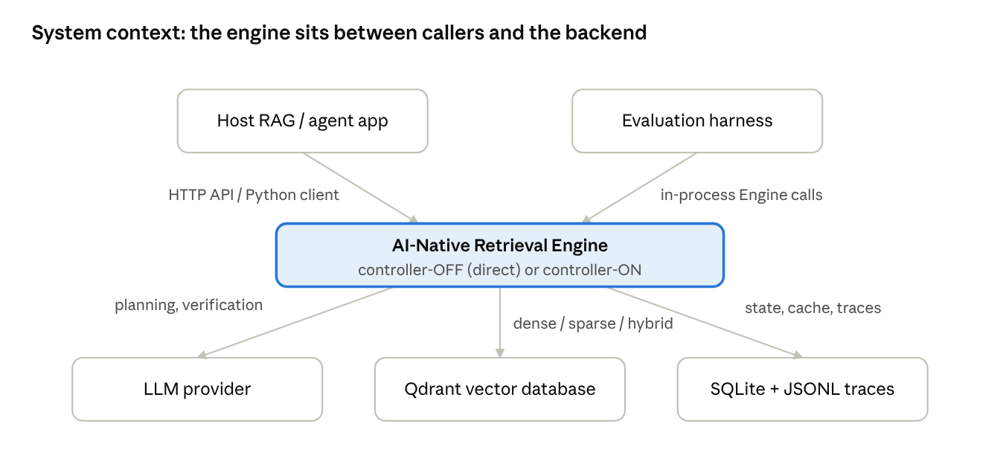
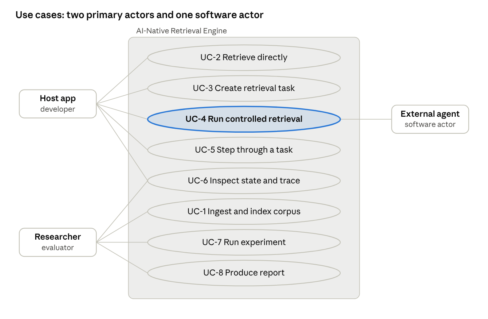

# Software Requirements Specification (SRS)

**AI-Native Retrieval Engine for Agentic Workflows**

Version 1.1 · 4 October 2026

This SRS defines what the AI-Native Retrieval Engine must do, for FYP-I and FYP-II, as 12 functional requirements (FR1–FR12) and 7 non-functional requirement groups, each with testable acceptance criteria. It follows the IEEE 830 / ISO/IEC/IEEE 29148 structure. The companion Software Design Specification (SDS) describes how the requirements are met.

## Document control

| Field | Value |
| --- | --- |
| Project | AI-Native Retrieval Engine for Agentic Workflows |
| Programme | BS (Computer Science), Session Fall 2026 |
| Institution | Department of Computer Science, FAST School of Computing, FAST-NUCES Karachi |
| Project type / nature | Traditional · Development |
| Area | Artificial Intelligence, Natural Language Processing, Information Retrieval / Agentic RAG |
| SDG | Industry, Innovation and Infrastructure |
| Supervisor | Zulfiqar Ali Memon |
| Source document | FYP Proposal, 18 September 2026 |

| Reg. # | Name | Primary responsibility |
| --- | --- | --- |
| 23K-0620 | Samay Kumar | Retrieval state, controller, utility, reranking, evidence management, stopping |
| 23K-0040 | Vishal Kothari | Query planner, service/API, LLM client, baselines, trajectory logging, evaluation, testing, agent integration |
| 23K-0702 | Kabir Raj | Data ingestion, Qdrant retrieval backend, controller-OFF direct path, cache/reuse, infrastructure |

| Version | Date | Author | Change |
| --- | --- | --- | --- |
| 1.0 | 26 Sep 2026 | Project team | Initial SRS, derived from the approved proposal |
| 1.1 | 4 Oct 2026 | Project team | Windows-only environment; supervisor and approval signatures; ownership aligned with proposal Table II; NDCG@k added; open items updated |

| Approval | Name | Signature | Date |
| --- | --- | --- | --- |
| Supervisor | Zulfiqar Ali Memon | Zulfiqar |  |
| Group members | Samay Kumar, Vishal Kothari, Kabir Raj | Samay, Vishal, Kabir |  |

## 1. Introduction

### 1.1 Purpose

This document specifies the requirements of a standalone retrieval-control engine for multi-step (agentic) retrieval. Its readers are the supervisor and evaluators (assessment), the three developers (implementation and testing), and any future maintainer. Every requirement has an identifier used by the SDS, the test suite and the traceability matrix in Appendix A.

### 1.2 Product scope

The product is middleware that sits between an existing RAG or agent application and its search backend (Qdrant). It does not replace the retriever, the reranker model or the answer generator. It adds:

- task-scoped retrieval state for each information need;
- bounded query planning (decomposition and rewriting) with grounding checks;
- task-local caching and reuse of intermediate results;
- adaptive selection among six retrieval actions using a transparent utility function;
- state-aware reranking and evidence management;
- budget-aware stopping;
- a controller-OFF bypass that performs normal one-shot retrieval through the same backend.

The engine returns an evidence bundle, trajectory metadata and a stop reason. The host application generates the final answer. The main benefit is fewer redundant retrieval calls and lower cost for multi-hop tasks at comparable accuracy, measured against one-shot and fixed-iteration baselines on MultiHop-RAG and HotpotQA.

### 1.3 Definitions, acronyms and abbreviations

| Term | Meaning |
| --- | --- |
| RAG | Retrieval-Augmented Generation |
| Host application | External RAG or agent app that calls the engine and owns answer generation |
| Controller-OFF (direct mode) | One-shot retrieval through the engine's retriever adapter, with no state or control |
| Controller-ON (controlled mode) | Stateful, iterative retrieval governed by the controller |
| Task | One information need (for example one benchmark question), identified by task\_id |
| Retrieval state S\_t | (G, g\_t, E\_t, Q\_t, R\_t, B\_t): goal, current subgoal, accumulated evidence, query history, retrieval history, remaining budget |
| Gap | A sub-question the task still needs answered; statuses open, resolved, superseded, exhausted |
| Step | One controller iteration: optional planning, one action, scoring, monitoring, persistence |
| Retrieval call | One backend search (DENSE, SPARSE\_HYBRID or RERANK\_EXPAND) |
| Action | REUSE, DENSE, SPARSE\_HYBRID, TRANSFORM, RERANK\_EXPAND or STOP |
| Evidence bundle | Final output: accepted evidence, gaps, stop reason, trace summary |
| Evidence gain | Per-step progress score in \[0,1\] |
| CER | Complete-evidence recall: share of tasks whose full gold evidence is in the bundle |
| Equal-budget / natural-policy | Comparison with the same retrieval-call cap / with each system's own stopping |
| HNSW | Hierarchical Navigable Small World graph (approximate nearest-neighbour index) |
| BM25 | Lexical ranking function used for sparse retrieval |
| RRF | Reciprocal Rank Fusion, used to merge dense and sparse results |
| LLM | Large language model |
| ADR | Architecture Decision Record |
| API | Application Programming Interface |
| MCP | Model Context Protocol |

### 1.4 References

1. FYP Proposal, *AI-Native Retrieval Engine for Agentic Workflows*, FAST-NUCES Karachi, 18 September 2026.
2. IEEE Std 830-1998, *Recommended Practice for Software Requirements Specifications*; ISO/IEC/IEEE 29148:2018.
3. P. Lewis et al., Retrieval-Augmented Generation for Knowledge-Intensive NLP Tasks, NeurIPS 2020.
4. Y. Tang and Y. Yang, MultiHop-RAG: Benchmarking RAG for Multi-Hop Queries, COLM 2024.
5. Y. A. Malkov and D. A. Yashunin, Efficient and Robust ANN Search Using HNSW Graphs, IEEE TPAMI 2020.
6. Project repository documentation set (`docs/`): PRD, ARCHITECTURE, STATE\_SPEC, ACTION\_POLICY, EVAL\_PROTOCOL and related specifications.
7. Remaining literature as listed in the proposal, references \[4\]–\[14\].

References are taken from the proposal; confirm details against the originals before final submission.

### 1.5 Document overview

Section 2 describes the product context and constraints. Section 3 defines external interfaces. Section 4 lists functional requirements by feature. Section 5 gives use cases. Section 6 lists non-functional requirements. Section 7 covers data, validation and scope limits. Appendix A traces requirements to modules, tests and milestones.

## 2. Overall description

### 2.1 Product perspective

The engine is a new, self-contained component, not part of an existing product. It is deployed as a local service and called by a host application over HTTP, or in-process by the evaluation harness. It depends on Qdrant for search, on an LLM provider for query planning, and on local SQLite and JSONL files for state, cache and traces.

*system context · 2 callers, 1 engine, 3 external services*

The host application keeps its own generator. When the controller is disabled, the host gets ordinary one-shot retrieval from the same backend, so its behaviour is unchanged.

### 2.2 Product functions

| ID | Function |
| --- | --- |
| PF-1 | Ingest and index benchmark corpora with dense and sparse representations |
| PF-2 | Serve one-shot direct retrieval (dense, sparse, hybrid) |
| PF-3 | Create and persist a retrieval task with explicit state S\_t and a budget |
| PF-4 | Decompose the goal into gaps and rewrite stagnating queries (bounded, grounded) |
| PF-5 | Select one of six actions per step with a transparent utility function |
| PF-6 | Reuse task-local cached results instead of repeating backend calls |
| PF-7 | Rerank candidates using relevance, gap coverage, novelty and redundancy |
| PF-8 | Accept evidence, resolve gaps and measure evidence gain |
| PF-9 | Stop on sufficiency, stagnation, low utility or budget exhaustion |
| PF-10 | Return an evidence bundle, trace and stop reason |
| PF-11 | Run baselines, experiments, ablations and statistics reproducibly |
| PF-12 | Integrate with an external agent through a thin client |

### 2.3 User classes and characteristics

| User class | Description | Frequency | Technical level |
| --- | --- | --- | --- |
| Host-application developer | Integrates the engine into a RAG or agent app through the API or client | Occasional | High (Python, HTTP) |
| Researcher / evaluator | Runs experiments, ablations and reports; the project team during FYP | Daily | High |
| Engine developer / maintainer | Extends modules, adapters and policies | Daily during development | High |
| External agent (software actor) | Calls the engine as a tool during its own reasoning | Per task | Not applicable |
| FYP supervisor / examiner | Reviews demos, traces and results; does not operate the system directly | Milestones | Medium |

There is no end-user graphical interface in scope; interaction is through the API, the Python client, the command line and generated reports.

### 2.4 Operating environment

- **OS:** Windows 10 or Windows 11 (64-bit).
- **Runtime:** Python 3.11; Qdrant as the native Windows binary (`qdrant.exe`).
- **Hardware:** a student laptop with 8 GB RAM minimum (16 GB recommended), about 10 GB free disk; GPU optional.
- **Network:** localhost for engine and Qdrant; internet only for model downloads and a hosted LLM API if used.

### 2.5 Design and implementation constraints

- **C-1** Python 3.11, FastAPI, Pydantic v2, LangGraph, Qdrant, Sentence-Transformers, as approved in the proposal.
- **C-2** No fine-tuning or reinforcement-learning training in the core deliverable; pretrained models only.
- **C-3** The controller policy is deterministic code, not an LLM.
- **C-4** One shared index, embedder, reranker and answer generator for all compared systems.
- **C-5** Task-local caching only in reported experiments.
- **C-6** LLM usage bounded per task and per run to fit a student budget.
- **C-7** Timeline: FYP-I delivers about 50–60% of functional scope by December 2026; FYP-II completes it by June 2027.
- **C-8** Code, data handling and tool use comply with FAST-NUCES FYP and academic-integrity policies.

### 2.6 User documentation

Setup guide, API reference (OpenAPI at `/docs`), client usage guide, experiment guide, and the specification set in the repository `docs/` folder.

### 2.7 Assumptions and dependencies

- **A-1** MultiHop-RAG and HotpotQA remain publicly available under licences that permit academic use.
- **A-2** A host system exposes a retrieval interface that can be wrapped by an adapter.
- **A-3** A capable LLM (hosted or local) is available that produces valid JSON for planning in at least 95% of calls.
- **A-4** Pretrained embedding and cross-encoder models run acceptably on CPU at MultiHop-RAG scale (about 600 articles).
- **A-5** Qdrant supports named dense and sparse vectors and hybrid fusion in the pinned version.
- **D-1** Qdrant, Hugging Face model hub, the chosen LLM provider, Python package index.

## 3. External interface requirements

### 3.1 User interfaces

The product has no graphical UI. Users interact through four surfaces.

| ID | Interface | Requirement |
| --- | --- | --- |
| UI-1 | REST API with OpenAPI docs | Interactive documentation rendered at `/docs`, listing every endpoint, schema and error code |
| UI-2 | Python client | Typed methods `create_task`, `step`, `run`, `get_result`, `get_state`, `get_trace`, `retrieve_direct` |
| UI-3 | Command line (PowerShell + Python modules) | `python -m data.ingest`, `python -m uvicorn` (serve), `python -m eval.run`, `python -m eval.report`, `pytest` with documented parameters |
| UI-4 | Trace viewer and reports | `show_trace.py` prints a trajectory step by step; reports produce Markdown tables and PNG figures |

### 3.2 Software interfaces

| ID | External software | Direction | Purpose | Protocol / format |
| --- | --- | --- | --- | --- |
| SI-1 | Qdrant vector database | Engine → Qdrant | Index and search dense (HNSW) and sparse (BM25) vectors; hybrid fusion (RRF) | Qdrant client over REST/gRPC, localhost |
| SI-2 | LLM provider (hosted API or local OpenAI-compatible server) | Engine → provider | Query planning, optional evidence verification; answer generation in the evaluation harness | HTTPS / HTTP JSON |
| SI-3 | Hugging Face model hub | Engine → hub (setup only) | Download embedding and cross-encoder models | HTTPS |
| SI-4 | SQLite | Engine ↔ file | Persist task state, cache entries, LLM response cache | Local file, WAL mode |
| SI-5 | Host application | Host → Engine | Create tasks, run retrieval, obtain evidence bundles | REST JSON over HTTP |
| SI-6 | LangGraph | Internal library | Stateful execution of the control loop | Python API |
| SI-7 | Benchmark datasets | Files → Engine | MultiHop-RAG, HotpotQA, curated tasks | JSON / JSONL |

### 3.3 Hardware interfaces

No special hardware. Optional CUDA GPU for faster embedding and reranking, selected by configuration (`embedding.device`, `rerank.device`).

### 3.4 Communications interfaces

- **CI-1** HTTP/1.1 with JSON bodies (UTF-8) between host and engine; base path `/v1`.
- **CI-2** The engine binds to 127.0.0.1 by default; exposure beyond localhost requires an explicit configuration change and an optional bearer token.
- **CI-3** Outbound HTTPS only to the configured LLM provider and model hub.
- **CI-4** Every error response uses one body shape: `{"error": {"code", "message", "task_id"}}`, with HTTP status codes 404, 409, 422, 429, 500, 502, 503 or 504 as defined in the API contract.

## 4. Functional requirements

The system shall satisfy FR1–FR12. Priority: **H** = mandatory for the final product, **M** = mandatory but may be simplified in FYP-I. Phase = the milestone by which a first working version is due.

| ID | Feature | Priority | Phase |
| --- | --- | --- | --- |
| FR1 | Corpus ingestion and indexing | H | FYP-I, Week 10 |
| FR2 | Task-scoped retrieval state | H | FYP-I, Week 12 |
| FR3 | Controller-OFF and controller-ON modes | H | FYP-I, Week 10 |
| FR4 | Bounded query planning | H | FYP-I, Week 12 |
| FR5 | Task-local caching and reuse | H | FYP-I, Week 16 |
| FR6 | Adaptive action selection | H | FYP-I, Week 16 |
| FR7 | State-aware reranking | M | FYP-I prototype, FYP-II final |
| FR8 | Evidence management and stopping | H | FYP-I basic, FYP-II final |
| FR9 | Evidence-bundle return contract | H | FYP-I, Week 12 |
| FR10 | Tracing and metrics | H | FYP-I, Week 12 |
| FR11 | Service, client and agent adapter | H | FYP-I client, FYP-II agent |
| FR12 | Benchmark format support | M | FYP-I MultiHop-RAG, FYP-II others |

### 4.1 FR1 — Corpus ingestion and indexing

The system ingests benchmark corpora reproducibly into one shared Qdrant index.

| ID | Requirement | Acceptance criterion |
| --- | --- | --- |
| FR1.1 | The system shall normalise and chunk documents with a fixed, sentence-aware policy (configured size and overlap). | Two ingestion runs yield identical chunk IDs and counts. |
| FR1.2 | The system shall assign each chunk a deterministic ID and store it with doc ID, text, source, date and character span. | Payload fields present for 100% of points. |
| FR1.3 | The system shall index a dense vector and a sparse (BM25) vector per chunk in one collection. | Dense, sparse and hybrid queries all return results. |
| FR1.4 | The system shall map benchmark gold evidence to chunk IDs. | At least 95% of gold evidence entries mapped; unmapped list saved. |
| FR1.5 | The system shall produce a fixed, stratified dev/test split recorded in a committed file. | Split file hash unchanged across runs. |
| FR1.6 | The system shall write an ingestion manifest (config hash, models, counts, collection name). | Manifest present after every ingestion. |

### 4.2 FR2 — Task-scoped retrieval state

| ID | Requirement | Acceptance criterion |
| --- | --- | --- |
| FR2.1 | The system shall create a task with a unique task\_id, a goal and a budget (steps, retrieval calls, LLM calls, tokens). | `POST /v1/tasks` returns 201 with S\_0. |
| FR2.2 | The system shall maintain S\_t = (G, g\_t, E\_t, Q\_t, R\_t, B\_t) plus control bookkeeping for each task. | State model matches the specification exactly. |
| FR2.3 | The system shall persist state after every completed step and survive a restart. | State readable after server restart. |
| FR2.4 | The system shall reject concurrent steps on the same task. | Second concurrent call returns 409. |
| FR2.5 | The system shall enforce state invariants (budget caps, unique evidence, append-only histories). | Invariant tests pass after every step. |

### 4.3 FR3 — Controller-OFF and controller-ON modes

| ID | Requirement | Acceptance criterion |
| --- | --- | --- |
| FR3.1 | The system shall provide direct retrieval in dense, sparse and hybrid modes without creating state. | `POST /v1/retrieve/direct` works for all three modes. |
| FR3.2 | The system shall optionally apply relevance-only reranking in direct mode. | `rerank=true` returns relevance scores. |
| FR3.3 | Both modes shall use the same retriever adapter, index and models. | Single adapter instance per process. |
| FR3.4 | Direct mode shall remain available when controlled components fail. | Direct call succeeds with the planner disabled. |

### 4.4 FR4 — Bounded query planning

| ID | Requirement | Acceptance criterion |
| --- | --- | --- |
| FR4.1 | At task start the system shall decompose the goal into 1 to 3 subgoals, each with a query and need type (semantic, lexical, mixed). | Gaps created in state. |
| FR4.2 | On stagnation the system shall rewrite the current query or split the current gap. | TRANSFORM produces a new query or child gaps. |
| FR4.3 | Planner output shall conform to a fixed schema. | Schema-invalid output rejected. |
| FR4.4 | Every named entity, date or identifier in planner output shall be traceable to the goal or accepted evidence. | Hallucinated entity rejected in tests. |
| FR4.5 | The planner shall make at most 2 LLM attempts per invocation, then fall back deterministically. | Exactly 2 calls, then fallback, in tests. |
| FR4.6 | The planner shall never write evidence. | Ownership test passes. |
| FR4.7 | Every accept, reject and fallback shall be logged with a reason code. | Events present in traces. |

### 4.5 FR5 — Task-local caching and reuse

| ID | Requirement | Acceptance criterion |
| --- | --- | --- |
| FR5.1 | The system shall cache each fresh retrieval result per task (query, mode, candidates, accepted IDs). | Entry written after each retrieval. |
| FR5.2 | The system shall detect equivalent queries by exact normalised match or embedding similarity above a threshold. | Paraphrase test hits; unrelated query misses. |
| FR5.3 | A cache hit shall enable a REUSE action that makes no backend call. | Zero retrieval calls for REUSE steps. |
| FR5.4 | Cache entries shall never be visible to another task. | Cross-task leakage test passes. |
| FR5.5 | A cached entry shall serve a need only if its retrieval mode is compatible. | Dense entry does not serve a lexical need. |

### 4.6 FR6 — Adaptive action selection

| ID | Requirement | Acceptance criterion |
| --- | --- | --- |
| FR6.1 | Each step the system shall select one action from REUSE, DENSE, SPARSE\_HYBRID, TRANSFORM, RERANK\_EXPAND, STOP. | One action per step in traces. |
| FR6.2 | Selection shall apply budget guards and preconditions before utility scoring. | Branch tests for each rule. |
| FR6.3 | Eligible actions shall be scored with Utility = αG − βC − γR − δL, all signals normalised to \[0,1\], weights non-negative and summing to 1. | Worked-example unit test reproduces the specified numbers. |
| FR6.4 | Selection shall be deterministic for a given state and configuration, with a fixed tie-break order. | Repeated calls return the same action. |
| FR6.5 | The system shall switch retrieval strategy (dense vs sparse/hybrid) when the preferred mode stagnates or was already tried. | Strategy-switch test passes. |
| FR6.6 | Each decision shall log the eligible set, all signal values and the rule that fired. | `controller.decision` event complete. |

### 4.7 FR7 — State-aware reranking

| ID | Requirement | Acceptance criterion |
| --- | --- | --- |
| FR7.1 | The system shall score candidates with a pretrained cross-encoder, mapped to \[0,1\]. | Relevance within \[0,1\]. |
| FR7.2 | The system shall combine relevance with gap coverage and novelty, and penalise redundancy among selected candidates. | Constructed test: novel, gap-covering candidate outranks a near-duplicate with higher relevance. |
| FR7.3 | With state-awareness disabled, order shall equal cross-encoder order. | Ablation test passes. |
| FR7.4 | No new reranking model shall be trained. | Only pretrained weights used. |

### 4.8 FR8 — Evidence management and stopping

| ID | Requirement | Acceptance criterion |
| --- | --- | --- |
| FR8.1 | The system shall accept a candidate as evidence only if it is new, relevant and novel above thresholds. | Rejection codes logged for each failed check. |
| FR8.2 | The system shall mark a gap resolved when accepted evidence covers it above a threshold (optional LLM verification). | Threshold tests pass. |
| FR8.3 | The system shall compute a per-step evidence gain in \[0,1\]. | Property test: gain within range. |
| FR8.4 | The system shall detect stagnation and replan once before giving up on a gap. | Monitor tests pass. |
| FR8.5 | The system shall stop with a distinct reason: all gaps resolved, stagnation, low marginal utility, or step, retrieval-call, LLM-call or token budget exhausted. | Each reason reachable in tests. |
| FR8.6 | Budget caps shall never be exceeded. | Invariant test passes. |

### 4.9 FR9 — Evidence-bundle return contract

| ID | Requirement | Acceptance criterion |
| --- | --- | --- |
| FR9.1 | On termination the system shall return accepted evidence (sorted by score), gaps, stop reason and a trace summary. | Bundle validates against schema. |
| FR9.2 | The engine shall never return generated answer text. | No answer field in any response. |

### 4.10 FR10 — Tracing and metrics

| ID | Requirement | Acceptance criterion |
| --- | --- | --- |
| FR10.1 | Every system (engine and baselines) shall write one trace record per step in a shared schema. | Schema test on all systems. |
| FR10.2 | Each run shall write a manifest with git commit, config hash, versions, prompts, seeds and collection. | Run refused as reportable without it. |
| FR10.3 | The system shall compute retrieval, evidence, task and efficiency metrics from traces, bundles and gold data only. | Metric tests on hand-built traces. |
| FR10.4 | The system shall compute paired bootstrap confidence intervals and McNemar tests. | Statistics module tests pass. |

### 4.11 FR11 — Service, client and agent adapter

| ID | Requirement | Acceptance criterion |
| --- | --- | --- |
| FR11.1 | The system shall expose the endpoints: health, create task, step, run, result, state, trace, direct retrieval. | OpenAPI lists all eight. |
| FR11.2 | A Python client shall wrap every endpoint with typed methods and mapped exceptions. | Client tests pass. |
| FR11.3 | An external LangGraph agent demo shall use the engine only through the client. | Import-boundary test passes. |
| FR11.4 | The demo shall run in direct and controlled mode. | Demo runs on 5 fixture questions in both modes. |

### 4.12 FR12 — Benchmark format support

| ID | Requirement | Acceptance criterion |
| --- | --- | --- |
| FR12.1 | MultiHop-RAG, HotpotQA and the curated benchmark shall load into one common task format. | One loader interface; no dataset branches in the runner. |
| FR12.2 | The system shall support a curated benchmark of 40–60 research-synthesis and codebase-navigation tasks with evidence groups and reviewer metadata. | Curated file validates against its schema. |

## 5. Use cases

### 5.1 Actors

| Actor | Type | Goal |
| --- | --- | --- |
| Host application / developer | Primary | Obtain better evidence for multi-step questions without rebuilding the RAG stack |
| Researcher / evaluator | Primary | Build indexes, run fair comparisons and produce reports |
| External agent | Primary (software) | Gather evidence as a tool call during its own reasoning |
| Qdrant | Secondary | Execute searches |
| LLM provider | Secondary | Plan queries, verify evidence, generate answers (evaluation only) |

### 5.2 Use-case diagram

*use-case diagram · 8 use cases, 3 actors*

UC-4 is the core use case; UC-3 and UC-5 are its setup and step-wise variant. Qdrant serves UC-1, UC-2, UC-4 and UC-5; the LLM provider serves UC-4, UC-5 and UC-7.

### 5.3 UC-4 Run controlled retrieval (detailed)

| Field | Description |
| --- | --- |
| Primary actor | Host application or external agent |
| Requirements | FR2, FR4–FR10 |
| Preconditions | Engine running; collection indexed (UC-1); task created (UC-3) with status active |
| Trigger | `POST /v1/tasks/{task_id}/run` or `client.run(task_id)` |
| Postconditions (success) | Task status stopped; stop reason set; bundle available via `/result`; trace persisted |
| Postconditions (failure) | Stored state equals the last completed step; error returned with a code |

**Main flow**

1. The engine loads S\_t for the task.
2. On the first step, the planner decomposes the goal into gaps and sets the current gap and pending query.
3. The engine looks up the task-local cache for the pending query.
4. The controller applies budget guards and preconditions, scores eligible actions, and selects one.
5. The engine executes the action (reuse, dense or sparse/hybrid search, expansion, or query rewrite).
6. If candidates were produced, the reranker scores them and the evidence manager accepts evidence, resolves gaps and computes evidence gain.
7. The monitor updates stagnation, advances or exhausts gaps and checks stop conditions.
8. The engine persists S\_t and appends a trace step.
9. Steps 3–8 repeat until a stop condition holds; the engine returns the evidence bundle.

**Alternative and exception flows**

- **4a** A budget is exhausted: the controller selects STOP with the matching reason.
- **4b** No eligible action remains: STOP with STAGNATION or MAX\_LLM\_CALLS.
- **5a** Planner output invalid twice: deterministic fallback query is used; events logged.
- **5b** Qdrant unavailable: step aborted, state unchanged, error 503 BACKEND\_ERROR.
- **5c** LLM provider failure after retries: step aborted, error 502 LLM\_ERROR.
- **9a** Run exceeds the server timeout: 504 RUN\_TIMEOUT; caller may continue with UC-5.
- **1a** Task already stopped: 409 TASK\_NOT\_ACTIVE.

### 5.4 Other use cases

| ID | Name | Actor | Preconditions | Main flow (summary) | Postcondition | FR |
| --- | --- | --- | --- | --- | --- | --- |
| UC-1 | Ingest and index corpus | Researcher | Dataset downloaded; Qdrant running | Load, normalise, chunk, embed (dense + sparse), upsert, map gold evidence, write split and manifest | Collection ready; gold map ≥ 95% coverage | FR1, FR12 |
| UC-2 | Retrieve directly | Host app | Collection indexed | Submit query, mode, k; optionally rerank; receive candidates | No state created | FR3 |
| UC-3 | Create retrieval task | Host app, agent | Engine running | Submit goal and optional budget; engine validates and persists S\_0 | Task active with task\_id | FR2 |
| UC-5 | Step through a task | Host app | Task active | Call step repeatedly; each call runs one iteration and returns action, new evidence, open gaps, budget | Task progresses one step | FR2, FR6, FR11 |
| UC-6 | Inspect state and trace | Host app, researcher | Task exists | Read state or full trace; or print with the trace viewer | Read-only | FR10, FR11 |
| UC-7 | Run experiment | Researcher | Collection, split, config ready | Select system, split, budgets; harness runs tasks, generates answers with the shared generator, writes traces, bundles, metrics, manifest | Run folder complete | FR10, FR12 |
| UC-8 | Produce report | Researcher | Completed runs | Aggregate metrics, compute statistics, draw figures | Tables and figures in report folder | FR10 |

## 6. Non-functional requirements

Each NFR is measurable. Performance targets are provisional and will be confirmed against the first profiled runs (Week 14); any change is recorded in an ADR.

### 6.1 Performance and efficiency

| ID | Requirement | Measure / target |
| --- | --- | --- |
| NFR-P1 | Direct retrieval latency (dense, k = 20, CPU, localhost) | Median ≤ 200 ms excluding reranking |
| NFR-P2 | Controller overhead per step (planning excluded) | Median ≤ 100 ms for selection, cache lookup, evidence update and monitoring |
| NFR-P3 | Cross-encoder reranking of 20 candidates on CPU | Median ≤ 1.5 s |
| NFR-P4 | Per-task LLM usage | Never exceeds `max_llm_calls` and `max_tokens`; defaults 6 calls, 20,000 tokens |
| NFR-P5 | Per-run cost | Hard stop at `llm.max_cost_usd_per_run` (default USD 10) |
| NFR-P6 | Efficiency outcome (validation target) | About 15–25% fewer retrieval or redundant calls than fixed-iteration at accuracy and CER within 2–3 percentage points |
| NFR-P7 | Throughput for evaluation | A 300-task dev-subset run completes within 3 hours on a team laptop with 4 worker threads |

### 6.2 Reliability and availability

| ID | Requirement |
| --- | --- |
| NFR-R1 | A backend or LLM failure during a step shall not corrupt stored state; the task remains at its last completed step. |
| NFR-R2 | Transport errors to the LLM provider shall be retried with exponential backoff up to a configured limit. |
| NFR-R3 | Direct mode shall remain usable when planner, cache or controller components are disabled. |
| NFR-R4 | Task state and cache shall survive a server restart (SQLite persistence). |
| NFR-R5 | Concurrent evaluation workers on different tasks shall not block each other (SQLite WAL mode). |

### 6.3 Security

| ID | Requirement |
| --- | --- |
| NFR-S1 | API keys shall be stored only in environment variables or an uncommitted `.env` file; a secret scanner runs on every commit. |
| NFR-S2 | Keys and raw credentials shall never appear in logs, traces or error messages. |
| NFR-S3 | The service shall bind to localhost by default; remote exposure requires explicit configuration and an optional bearer token. |
| NFR-S4 | Retrieved text shall be treated as untrusted: never placed in a system prompt, always wrapped in delimited evidence blocks. |
| NFR-S5 | Action selection, caching and stopping shall not depend on LLM output, so injected text cannot choose actions directly. |
| NFR-S6 | Request bodies shall be size- and type-validated. |

### 6.4 Reproducibility

| ID | Requirement |
| --- | --- |
| NFR-X1 | Every run shall record git commit, clean-tree flag, resolved config and hash, package versions, prompt hashes, models, seeds, collection and split hash. |
| NFR-X2 | Dataset versions shall be checksummed; the dev/test split shall be fixed and committed. |
| NFR-X3 | Calibrated weights and thresholds shall be frozen before test-split evaluation. |
| NFR-X4 | A clean machine following the setup guide shall reproduce reported tables from saved configs. |

### 6.5 Maintainability and modularity

| ID | Requirement |
| --- | --- |
| NFR-M1 | Planner, cache, controller policy, retriever, reranker, evidence manager, LLM provider and agent integration shall each be replaceable by configuration plus at most one new class. |
| NFR-M2 | Modules shall depend only on interfaces and shared models; concrete classes are chosen in one factory. |
| NFR-M3 | No thresholds, weights, model names or paths shall be hard-coded; all are configuration keys. |
| NFR-M4 | Code shall pass lint (ruff) and strict type checking (mypy) in continuous integration. |
| NFR-M5 | Unit-test line coverage shall be at least 85% for controller, evidence, monitor, planner and cache, and at least 70% overall. |

### 6.6 Usability

| ID | Requirement |
| --- | --- |
| NFR-U1 | A developer shall be able to integrate a host app using only the API reference and client, with an adapter under about 50 lines. |
| NFR-U2 | Every error shall return a stable code and a human-readable message. |
| NFR-U3 | A new team member shall reach a passing test suite in under 1 hour using the setup guide. |

### 6.7 Observability

| ID | Requirement |
| --- | --- |
| NFR-O1 | Every planned query, cache decision, action, result set, rerank score, state update, latency, token count and stop reason shall be logged. |
| NFR-O2 | Logs shall be structured JSON with run, task and step identifiers. |
| NFR-O3 | Any trajectory shall be viewable step by step with the trace viewer. |

### 6.8 Portability and legal

| ID | Requirement |
| --- | --- |
| NFR-L1 | The system shall run natively on Windows 10 and Windows 11 (64-bit). |
| NFR-L2 | Datasets and models shall be used under their licences; third-party corpora shall not be committed. |
| NFR-L3 | AI-assistance in development shall follow FAST-NUCES policy and be acknowledged in the report. |

## 7. Data requirements

| ID | Data | Source | Size (approx.) | Requirement |
| --- | --- | --- | --- | --- |
| DR-1 | MultiHop-RAG corpus and queries | Tang and Yang, COLM 2024 | About 600 news articles, about 2,500 queries of four types (inference, comparison, temporal, null) | Primary benchmark; source, licence and checksums recorded before use |
| DR-2 | HotpotQA (distractor setting) | Public release | Sample of about 1,000 questions, pooled paragraphs | Secondary generalisation benchmark |
| DR-3 | Curated benchmark | Team-authored | 40–60 tasks | Research-synthesis and exploratory codebase-navigation tasks, double-annotated |
| DR-4 | Gold-evidence map | Derived from DR-1/DR-2 | One entry per task | Groups of chunk IDs; any member satisfies a group |
| DR-5 | Dev/test split | Derived | 70/30, stratified by question type | Fixed seed, committed, never regenerated after freeze |
| DR-6 | Task state, cache, LLM cache | Runtime | Per task | SQLite; vectors persisted but excluded from API output |
| DR-7 | Traces, bundles, manifests | Runtime | Per run | JSON/JSONL; archived for reported runs |

Counts are approximate and will be replaced by observed values when the dataset is downloaded. Null queries have no gold evidence; they are excluded from recall metrics and included in accuracy and efficiency metrics.

## 8. Validation requirements

Validation checks that the finished engine meets its purpose (proposal validation questions VQ1–VQ3).

| ID | Requirement |
| --- | --- |
| VR-1 | Compare four systems: one-shot dense, one-shot hybrid, fixed-iteration agentic RAG and controller-ON, on identical infrastructure. |
| VR-2 | Report equal-budget results (same retrieval-call cap, B = 2, 3, 4) as the primary comparison and natural-policy results alongside. |
| VR-3 | Report retrieval quality (Recall@k, Hit@k, MRR, NDCG@k), evidence quality (CER, partial coverage, redundancy), task accuracy (benchmark metric, EM/F1 for HotpotQA) and efficiency (calls, cache-hit rate, tokens, cost, latency, premature stops, over-retrieval). |
| VR-4 | Run one-at-a-time ablations of planning, cache, state-aware reranking, gap tracking, redundancy, budget awareness and adaptive actions. |
| VR-5 | Calibrate weights and thresholds on the dev split only; evaluate the test split once with the frozen configuration. |
| VR-6 | Report paired bootstrap 95% confidence intervals and McNemar tests; three repeats for LLM-dependent final runs. |
| VR-7 | If the validation target is not met, report measured limitations, component failures and trade-offs rather than claiming success. |

## 9. Out of scope

Cross-task semantic caching, graph and web retrieval adapters, reranker or foundation-model training, reinforcement-learning policies, long-term personal memory, multi-agent orchestration, multimodal RAG, custom ANN algorithms, production-scale distributed deployment, zero-code integration with closed RAG products, comprehensive adversarial-content detection, and empirical validation of backends other than Qdrant.

Stretch items, only if the schedule allows: an Adaptive-RAG-style router baseline, a lightweight learned policy, AgenticRAGTracer-compatible diagnostics, an MCP adapter, and a cross-task cache experiment.

## Appendix A — Requirements traceability matrix

| Req. | Use case | Design element (SDS) | Verification | Owner | Milestone |
| --- | --- | --- | --- | --- | --- |
| FR1 | UC-1 | Ingestion pipeline, QdrantAdapter, Embedder | Reproducibility integration test; gold-map coverage check | Kabir | Week 10 |
| FR2 | UC-3, UC-5 | RetrievalState, TaskStore | State invariant tests; restart test | Samay | Week 12 |
| FR3 | UC-2 | Engine.retrieve\_direct, API router | API contract tests | Kabir | Week 10 |
| FR4 | UC-4 | Planner, validator, prompts | Hallucination, fallback, count tests | Vishal | Week 12 |
| FR5 | UC-4 | TaskLocalCache | Hit/miss, leakage, compatibility tests | Kabir | Week 16 |
| FR6 | UC-4 | Controller, signals | Branch tests; worked-example test | Samay | Week 16 |
| FR7 | UC-4 | StateAwareReranker | FR7 constructed test; ablation test | Samay | Week 16 / FYP-II |
| FR8 | UC-4 | EvidenceManager, TrajectoryMonitor | Acceptance, gap, gain, stop-reason tests | Samay | Week 16 / FYP-II |
| FR9 | UC-4 | EvidenceBundle | Schema test | Samay | Week 12 |
| FR10 | UC-6, UC-7, UC-8 | Trace writer, metrics, stats, manifest | Metric tests on hand-built traces | Vishal | Week 12 |
| FR11 | UC-2–UC-6 | FastAPI app, RetrievalClient, agent demo | Client tests; import-boundary test | Vishal | Week 16 / FYP-II |
| FR12 | UC-1, UC-7 | Dataset loaders | Loader tests | Vishal, Kabir | Week 10 / FYP-II |
| NFR-R1 | UC-4 | Iteration abort before persist | Fault-injection tests | Samay | Week 15 |
| NFR-S4/S5 | UC-4 | Prompt construction, deterministic controller | Injection fixture test | Vishal | Week 12 |
| NFR-X1–X4 | UC-7 | Run manifest, frozen config | Reproducibility checklist; clean-machine test | All | FYP-II |

## Appendix B — Open items (to be resolved)

| ID | Item | Resolved by | Owner |
| --- | --- | --- | --- |
| TBD-1 | Observed corpus and query counts, checksums of the downloaded files, question-type labels and split hash (source, licence and official metrics are recorded in ADR-003) | ADR-003 | Kabir |
| TBD-2 | Planner and generator LLM models, and cost per run | ADR-004 after a 50-task pilot | Vishal |
| TBD-3 | Final embedding model, chunk size, cross-encoder | ADR-001, ADR-005 | Kabir, Samay |
| TBD-4 | Confirmation of NFR-P1–P3 and P7 targets from profiled runs | Week 14 latency profile | Kabir |
| TBD-5 | Calibrated weights and thresholds | ADR-006, February 2027 | Samay |
| TBD-6 | Supervisor approval of the recorded deviations from the proposal (Windows-only setup, no LangGraph checkpointer, gain signal, planner inputs, cache storage) | ADR-011 | Team |

## Appendix C — Glossary

Section 1.3 defines the terms used here. The repository file `docs/GLOSSARY.md` holds the full project glossary and is kept consistent with this SRS.
